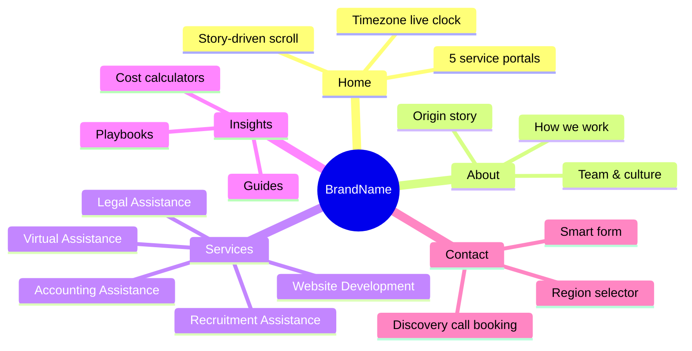
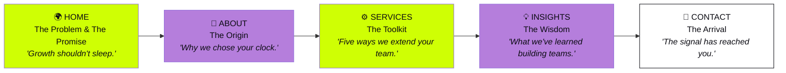
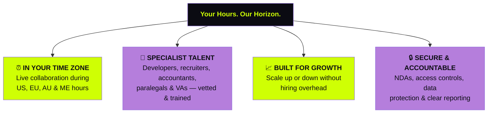
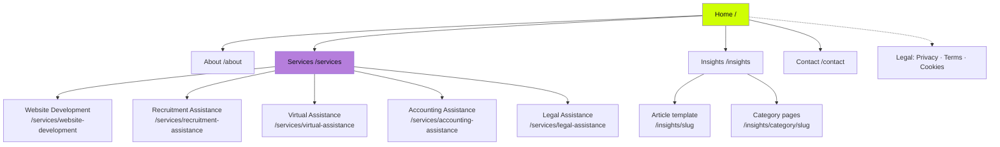
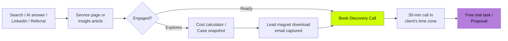
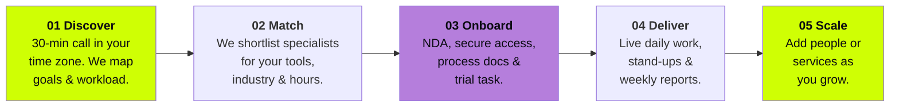
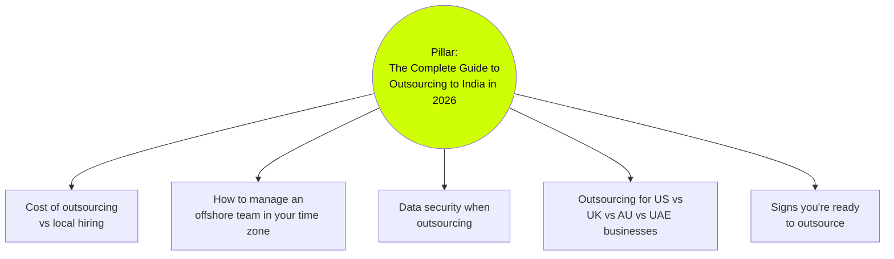
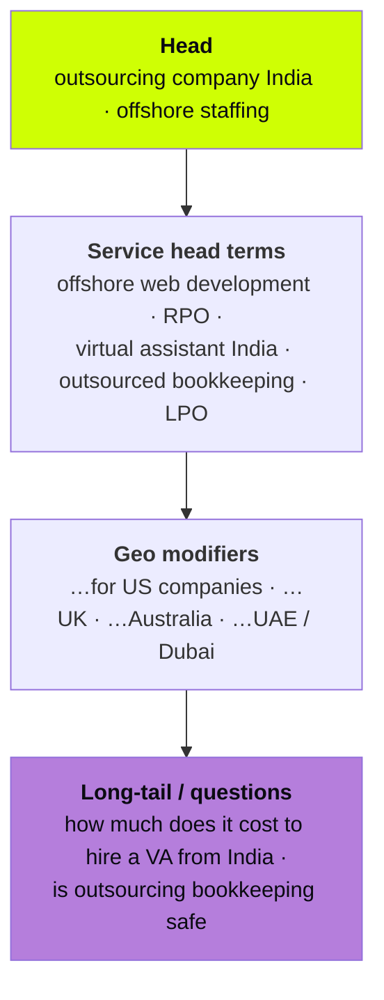
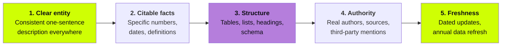
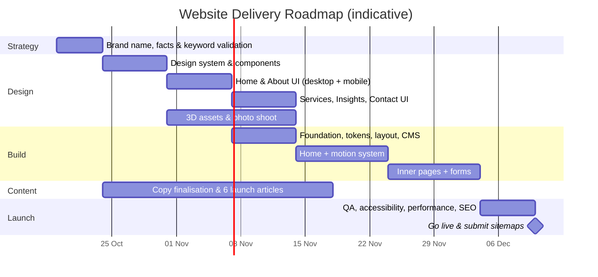

# Website Blueprint — Global Outsourcing Company
### Brand Storyline · Design System · Page-by-Page Content · SEO / AEO / GEO · Imagery Direction

> **Version:** 1.0 · **Prepared:** 15 October 2026
> **Brand name placeholder:** `[BrandName]` — replace globally once the name is final. Every other `[bracketed]` value (client counts, years, addresses) is a fact only you can supply; nothing has been invented.

---

## Table of Contents

1. [Project Snapshot](#1-project-snapshot)
2. [The Brand Storyline — "Your Hours. Our Horizon."](#2-the-brand-storyline)
3. [Brand Voice & Messaging Pillars](#3-brand-voice--messaging-pillars)
4. [Visual Design System](#4-visual-design-system)
5. [Motion, Scroll & Interaction System](#5-motion-scroll--interaction-system)
6. [Information Architecture & User Journeys](#6-information-architecture--user-journeys)
7. [Page-by-Page Blueprint & Copy](#7-page-by-page-blueprint--copy)
8. [SEO Strategy](#8-seo-strategy)
9. [AEO Strategy (Answer Engines)](#9-aeo-strategy-answer-engines)
10. [GEO Strategy (Generative Engines / AI Search)](#10-geo-strategy-generative-engines)
11. [Imagery & Visual Asset Creation](#11-imagery--visual-asset-creation)
12. [Component Library](#12-component-library)
13. [Accessibility, Performance & Trust](#13-accessibility-performance--trust)
14. [Recommended Tech Stack & Delivery Roadmap](#14-recommended-tech-stack--delivery-roadmap)
15. [Launch Checklist](#15-launch-checklist)

---

## 1. Project Snapshot

| Item | Detail |
|---|---|
| **Business** | Global outsourcing partner — Website Development, Recruitment, Virtual, Accounting & Legal Assistance |
| **Delivery base** | India (entire operations team) |
| **Markets served** | USA · Europe · Australia · Middle East |
| **Core differentiator** | Team works **in the client's working hours** — real-time collaboration, not overnight hand-offs |
| **Primary goal** | Generate qualified discovery calls from SMB & mid-market decision makers |
| **Secondary goals** | Rank for service + geography keywords; be cited by AI assistants as a trusted outsourcing source |
| **Palette** | `#CFFF04` Cyber Lime · `#B57EDC` Digital Lavender · `#FFFFFF` White (+ supporting dark neutral, see §4) |
| **Feel** | Bold, luxurious, artistic, technological, playful, connected |

### The website at a glance



---

## 2. The Brand Storyline

### 2.1 The core idea

> **"Your Hours. Our Horizon."**

Most outsourcing feels distant: emails sent at night, answers arriving tomorrow, a team you never really meet. `[BrandName]` flips that. Our people in India start their day when **yours** begins — whether that's 9 AM in New York, London, Sydney or Dubai. Different horizon, same working day.

The story is not about being *cheap* or *offshore*. It's about **presence** — a team that is *there*, live, in your meetings, on your Slack, during your hours — while bringing the depth of India's talent pool.

### 2.2 The narrative device: **"The Signal"**

A single glowing **Cyber Lime line** — *The Signal* — runs through the entire website. It is the visual metaphor for the always-on connection between your business and our team.

- It **starts** on the Home hero as a pulse leaving India on a 3D globe.
- It **travels** as you scroll, drawing paths between sections, wrapping around service cards, underlining key statements.
- It **branches** into five strands on the Services section — one per service.
- It **arrives** at the Contact page, where it lands on the visitor's own city (detected timezone) — *"The signal has reached you."*

Digital Lavender represents **the human side** — warmth, care, people. Lime represents **energy and technology**. Where they meet, the brand lives.

### 2.3 Story arc across the website



### 2.4 Story chapters on the Home page (scroll narrative)

| Chapter | Scroll moment | Headline | Emotion |
|---|---|---|---|
| **01 — The Tension** | Hero | *Growth shouldn't wait for tomorrow.* | Ambition, urgency |
| **02 — The Shift** | Globe rotates, clocks sync | *Your 9 AM is our 9 AM.* | Relief, curiosity |
| **03 — The Toolkit** | Signal splits into 5 | *One partner. Five ways to scale.* | Possibility |
| **04 — The Method** | Process timeline | *From hello to fully embedded in [X] days.* | Confidence |
| **05 — The Proof** | Metrics + testimonials | *Built for businesses that move fast.* | Trust |
| **06 — The Invitation** | CTA | *Let's start your day together.* | Action |

### 2.5 Brand essence pyramid

```
                         ▲
                        ╱ ╲
                       ╱   ╲         ESSENCE
                      ╱ ALWAYS╲      "Present, wherever you are."
                     ╱  THERE  ╲
                    ╱───────────╲
                   ╱  PERSONALITY ╲   Bold · Warm · Energetic
                  ╱  Confident ·   ╲  Creative · Solution-led
                 ╱   Playful · Sharp╲
                ╱────────────────────╲
               ╱   EMOTIONAL BENEFIT   ╲  "I can grow without
              ╱   Peace of mind · Momentum╲   burning out."
             ╱──────────────────────────────╲
            ╱      FUNCTIONAL BENEFIT          ╲  Skilled people, in your
           ╱  Real-time teams · Lower cost ·    ╲ hours, at a fraction
          ╱    Five services · One partner       ╲ of local hiring cost
         ╱────────────────────────────────────────╲
        ╱          PROOF & ATTRIBUTES                ╲  India-based talent ·
       ╱  [X]+ clients · 4 regions · secure processes  ╲ client-hour shifts
      ╱──────────────────────────────────────────────────╲
```

---

## 3. Brand Voice & Messaging Pillars

### 3.1 Voice principles

| Principle | We sound like… | We never sound like… |
|---|---|---|
| **Warm** | "We'll be on your team call at 9." | "Resources will be allocated." |
| **Modern** | Short sentences. Clear verbs. | Corporate jargon walls. |
| **Professional** | Specific, accurate, accountable. | Hype without proof. |
| **Energetic** | "Let's build it." | "We may be able to assist." |
| **Growth-focused** | Outcomes: time saved, pipeline filled, books closed. | Features with no "so what". |
| **Solution-oriented** | Problem → approach → result. | Selling before understanding. |

### 3.2 Messaging pillars



### 3.3 Signature lines (bank for headlines, social, ads)

- *Your hours. Our horizon.*
- *Growth shouldn't sleep. Neither should your support.*
- *A team in India. A desk in your day.*
- *Same working day. Different sunrise.*
- *Outsource the workload. Keep the momentum.*
- *Five services. One partner. Zero time-zone lag.*
- *We don't hand off. We show up.*

---

## 4. Visual Design System

### 4.1 Colour palette

The requested palette is vibrant and luminous. To achieve a **luxury, rich, ultra-realistic** feel *and* pass accessibility, it needs a deep supporting neutral. Lime and Lavender glow best against darkness.

| Role | Name | Hex | Use |
|---|---|---|---|
| **Primary accent** | Cyber Lime | `#CFFF04` | The Signal, CTAs, highlights, key numbers, hover states |
| **Secondary accent** | Digital Lavender | `#B57EDC` | Human moments, gradients, tags, testimonial accents |
| **Light** | White | `#FFFFFF` | Text on dark, light sections, cards |
| **Base (supporting)** | Midnight Ink | `#0B0B12` | Primary background — makes the accents feel premium |
| **Surface (supporting)** | Obsidian | `#16161F` | Cards, nav, elevated surfaces on dark |
| **Muted (supporting)** | Mist | `#A7A7B8` | Secondary text on dark |
| **Lavender deep (supporting)** | Plum Shadow | `#5B3A78` | Gradient depth, glass tints |

#### Colour ratio (60-30-10 adapted)

```
 ███████████████████████████████████████████████████████████  60%  Midnight Ink / Obsidian  (canvas)
 ██████████████████████████████                               25%  White                     (text, light sections)
 ██████████                                                    8%  Digital Lavender          (human warmth)
 █████                                                         7%  Cyber Lime                (energy & action)
```

#### Signature gradients

| Name | CSS | Use |
|---|---|---|
| **Aurora** | `linear-gradient(135deg, #CFFF04 0%, #B57EDC 100%)` | Hero text fill, CTA hover |
| **Dusk Glow** | `radial-gradient(circle at 30% 20%, #B57EDC55, transparent 60%)` | Section backgrounds |
| **Signal Trail** | `linear-gradient(90deg, transparent, #CFFF04, transparent)` | The animated Signal line |
| **Plum Depth** | `linear-gradient(180deg, #0B0B12 0%, #1E1530 100%)` | Footer, Contact |

#### ⚠️ Contrast rules (WCAG 2.2 AA)

| Combination | Approx. ratio | Verdict |
|---|---|---|
| Lime `#CFFF04` on Midnight `#0B0B12` | ~17:1 | ✅ Excellent — use freely |
| White on Midnight | ~19:1 | ✅ Body text |
| Lavender `#B57EDC` on Midnight | ~6.6:1 | ✅ Text OK |
| Midnight text on Lime button | ~17:1 | ✅ Primary CTA style |
| **Lime on White** | ~1.1:1 | ❌ **Never use for text or icons** |
| **White on Lavender** | ~2.9:1 | ❌ Only for large decorative text (≥ 24px bold), never body |
| Midnight on Lavender | ~6.6:1 | ✅ Tags, chips |

### 4.2 Typography

| Role | Typeface | Style | Size (desktop → mobile) |
|---|---|---|---|
| **Display** | *Clash Display* or *Space Grotesk* (bold, geometric) | 600–700, tight tracking (−2%) | 96–140px → 44–56px |
| **Editorial accent** | *Instrument Serif* *Italic* | Used for 1–2 words inside headlines for artistry | Matches display |
| **Headings** | *Space Grotesk* | 600 | H2 56→34px · H3 32→24px |
| **Body** | *Inter* | 400/500 | 18px / 1.65 → 16px |
| **Mono / data** | *JetBrains Mono* | 500 | Clocks, stats, labels — 14px |

**Signature headline treatment:** Sans-serif bold with one word swapped into italic serif and filled with the Aurora gradient.

> GROWTH SHOULDN'T *wait* FOR TOMORROW.

### 4.3 Layout & spacing

- **Grid:** 12 columns, 1440px max, 24px gutters (desktop) · 4 columns, 16px gutters (mobile)
- **Spacing scale (px):** 4 · 8 · 12 · 16 · 24 · 32 · 48 · 64 · 96 · 128 · 192
- **Section rhythm:** 160px vertical padding desktop / 96px mobile — generous space = luxury
- **Radius:** 4px (chips) · 16px (cards) · 32px (feature panels) · 999px (pills & buttons)
- **Elevation:** Glassmorphism on dark — `background: rgba(255,255,255,0.04); backdrop-filter: blur(24px); border: 1px solid rgba(255,255,255,0.08)`

### 4.4 Visual motifs

| Motif | Description |
|---|---|
| **The Signal** | 2px Cyber Lime line with soft glow (`box-shadow 0 0 24px #CFFF04`), drawn via SVG `stroke-dashoffset` on scroll |
| **Time rings** | Concentric thin circles with clock ticks — represents synchronized hours |
| **Liquid chrome** | Ultra-realistic 3D chrome/glass shapes tinted lime & lavender — luxury & tech |
| **Grain** | 3–4% film grain overlay on dark sections — rich, tactile, editorial |
| **Light leaks** | Lavender glow bleeding from section edges |

---

## 5. Motion, Scroll & Interaction System

### 5.1 Motion principles

1. **Connected** — every transition continues the Signal; nothing appears from nowhere.
2. **Purposeful** — motion explains (time syncing, process flowing), never just decorates.
3. **Playful, not chaotic** — one hero interaction per section.
4. **Respectful** — full `prefers-reduced-motion` fallback (static states, fades only).

### 5.2 Motion tokens

| Token | Value | Use |
|---|---|---|
| `ease-signature` | `cubic-bezier(0.22, 1, 0.36, 1)` | Most reveals |
| `ease-playful` | `cubic-bezier(0.34, 1.56, 0.64, 1)` | Buttons, chips (slight overshoot) |
| `dur-fast` | 180ms | Hover, focus |
| `dur-base` | 450ms | Element reveal |
| `dur-slow` | 900ms | Section transitions, text splits |
| `stagger` | 60ms | Lists, words, cards |

### 5.3 Signature interactions

| # | Interaction | Where | Behaviour |
|---|---|---|---|
| 1 | **Smooth scroll** | Global | Lenis inertia scroll (lerp 0.1), disabled for reduced motion |
| 2 | **Signal draw** | Global | Lime SVG path draws as user scrolls, connecting sections |
| 3 | **Living Globe** | Home hero | WebGL globe; arcs pulse from India to US/EU/AU/ME; drag to rotate |
| 4 | **Clock Sync** | Home ch.02 | Five clocks (your city + 4 regions) spin, then snap to "in sync" with lime flash |
| 5 | **Magnetic CTA** | All buttons | Button follows cursor within 40px radius |
| 6 | **Custom cursor** | Desktop | Lime dot + lavender ring; grows to "VIEW" / "DRAG" labels on interactive elements |
| 7 | **Split-text reveal** | Headlines | Words rise from mask with stagger |
| 8 | **Horizontal service rail** | Home ch.03 | Vertical scroll pins section and scrolls 5 service panels horizontally |
| 9 | **Tilt glass cards** | Service cards | 3D tilt (max 8°) with moving specular highlight |
| 10 | **Counter roll** | Stats | Numbers roll like an odometer on enter |
| 11 | **Marquee** | Industries / trust | Infinite kinetic type marquee, pauses on hover |
| 12 | **Page transition** | Route change | Lime wipe that becomes the next page's Signal |
| 13 | **Cost calculator** | Services | Sliders animate savings bar live |
| 14 | **Timezone detect** | Contact | Detects visitor's timezone: *"It's 10:42 in Chicago — our team is online now."* |

### 5.4 Scroll journey (Home)

```
 SCROLL ▼   0% ───────────────────────────────────────────────────────── 100%

 SECTION    │ HERO  │ CLOCK SYNC │ SERVICES RAIL (pinned) │ PROCESS │ PROOF │ CTA │
            │       │            │  → → → → →             │         │       │     │
 SIGNAL     ●═══════╪════════════╪══╦══╦══╦══╦══╗══════════╪═════════╪═══════╪═══◉ │
                                    ║  ║  ║  ║  ║   (splits into 5, rejoins)
 GLOBE      ████████▓▓▓▓▒▒░░       (fades & shrinks into corner badge)
 PACE       slow    medium        fast / pinned           medium    slow   still
```

---

## 6. Information Architecture & User Journeys

### 6.1 Sitemap



### 6.2 Navigation

- **Header (sticky, glass):** Logo · About · Services ▾ (mega-menu with 5 animated cards) · Insights · **[Book a Call]** (lime pill)
- **Header utility:** Live mini-clock — *"Team online · 10:42 your time"* with a pulsing lime dot
- **Footer:** Services list · Regions served · Insights categories · Contact details · Social · Legal · Newsletter

### 6.3 Primary user personas

| Persona | Region | Need | Lands on | Converts via |
|---|---|---|---|---|
| **Founder Fiona** — SaaS startup CEO | USA | Ship website + handle admin fast | Home / Web Dev | Discovery call |
| **HR Hamid** — Talent lead | UAE | Fill pipeline for 20 roles | Recruitment | Contact form |
| **Partner Paul** — Accounting firm owner | Australia | Tax-season capacity | Accounting | Pricing guide download → call |
| **Counsel Clara** — Law firm ops manager | UK / EU | Paralegal & drafting support | Legal | Call |
| **Busy Ben** — Agency owner | USA | Daily VA support | Virtual Assistance | Call |

### 6.4 Conversion funnel



---

## 7. Page-by-Page Blueprint & Copy

> **Format for each section:** Purpose → Layout → Copy → Interaction → Visual asset ID (see §11).

---

### 7.1 HOME PAGE  `/`

**SEO Title (≤ 60):** `Outsourcing Company in India for USA, UK, AU & UAE | [BrandName]`
**Meta Description (≤ 155):** `Dedicated offshore teams for web development, recruitment, virtual, accounting & legal assistance — working live in your business hours. Book a free call.`
**H1:** Growth shouldn't wait for tomorrow.

#### Section 1 — Hero (Chapter 01: The Tension)

- **Layout:** Full-viewport, Midnight Ink. 3D globe right (60% width), headline left. Signal pulse leaves India.
- **Eyebrow (mono):** `● TEAM ONLINE — WORKING IN YOUR TIME ZONE`
- **H1:** Growth shouldn't *wait* for tomorrow.
- **Subhead:** `[BrandName]` gives businesses in the USA, Europe, Australia and the Middle East a skilled offshore team in India — working live during **your** business hours. Web development, recruitment, virtual, accounting and legal support. One partner. No overnight lag.
- **CTAs:** **[Book a Free Discovery Call →]** (lime) · **[Explore Services]** (ghost)
- **Trust strip:** `[X]+ clients served · 4 regions · [X] specialists · NDA-first onboarding`
- **Interaction:** Globe drag; Signal arcs to whichever region the visitor hovers in a region chip row (🇺🇸 USA · 🇪🇺 Europe · 🇦🇺 Australia · 🇦🇪 Middle East).
- **Asset:** `IMG-H01` Living Globe.

#### Section 2 — Clock Sync (Chapter 02: The Shift)

- **H2:** Your 9 AM is our 9 AM.
- **Body:** Most offshore partners work while you sleep, so questions wait a day and momentum stalls. We do it differently. Our team in India runs shifts that mirror your working day — so we're on your calls, in your Slack, and answering in real time.
- **Infographic (interactive):** Five clocks snap into sync.

```
  ┌──────────────┬──────────────┬──────────────┬──────────────┬──────────────┐
  │  NEW YORK    │   LONDON     │   DUBAI      │   SYDNEY     │  YOUR TEAM   │
  │  09:00 EST   │  09:00 GMT   │  09:00 GST   │  09:00 AEST  │  ✔ ONLINE    │
  │   ◷          │   ◷          │   ◷          │   ◷          │  ● IN SYNC   │
  └──────────────┴──────────────┴──────────────┴──────────────┴──────────────┘
          ▲ Our shifts start when your day starts — wherever you are.
```

- **Three micro-benefits (icons):** Real-time replies · Live meetings & stand-ups · Same-day turnaround
- **Asset:** `IMG-H02` Time rings.

#### Section 3 — Services Rail (Chapter 03: The Toolkit)

- **H2:** One partner. *Five* ways to scale.
- **Intro:** Pick one service or combine several. Every team is trained in your tools, your process, and your hours.
- **Interaction:** Pinned horizontal scroll, each panel a full-height glass card with 3D object.

| Panel | Title | One-liner | CTA | Asset |
|---|---|---|---|---|
| 01 | **Website Development** | Fast, beautiful, conversion-ready websites and web apps — built by a dedicated dev team. | Build with us → | `IMG-S01` |
| 02 | **Recruitment Assistance** | Sourcing, screening and scheduling that keeps your hiring pipeline full. | Hire faster → | `IMG-S02` |
| 03 | **Virtual Assistance** | Skilled assistants who take admin, inbox and operations off your plate. | Get time back → | `IMG-S03` |
| 04 | **Accounting Assistance** | Bookkeeping, reconciliations and reporting your accountants can rely on. | Close books faster → | `IMG-S04` |
| 05 | **Legal Assistance** | Paralegal, research and document support for law firms and legal teams. | Scale your practice → | `IMG-S05` |

#### Section 4 — Why Us (Value comparison infographic)

- **H2:** Outsourcing, *upgraded*.

| | Traditional Offshore | Local Hire | **[BrandName]** |
|---|:---:|:---:|:---:|
| Works in your hours | ❌ | ✅ | ✅ |
| Cost-efficient | ✅ | ❌ | ✅ |
| Live collaboration | ❌ | ✅ | ✅ |
| Scale up/down quickly | ⚠️ | ❌ | ✅ |
| Multi-service, one partner | ❌ | ❌ | ✅ |
| Onboarding time | Weeks | Months | **[X] days** |

- **Interaction:** Our column glows lime; ticks pop in with `ease-playful`.

#### Section 5 — How It Works (Chapter 04: The Method)

- **H2:** From hello to fully embedded in *[X]* days.



- **Interaction:** Signal travels step to step as user scrolls; each step card lifts on arrival.

#### Section 6 — Proof (Chapter 05)

- **H2:** Built for businesses that *move* fast.
- **Animated stats (odometer):** `[X]+` clients · `[X]` countries · `[X]%` client retention · `[X]+` hours saved monthly
- **Testimonial carousel:** Glass cards, lavender quote mark, client photo, name, role, country flag. *(Use real, permissioned testimonials only.)*
- **Logo marquee:** Client / tool logos (with permission) — or tool stack: Slack · HubSpot · QuickBooks · Xero · Clio · Shopify · WordPress · React.

#### Section 7 — Industries marquee

Kinetic type, alternating lime/white/outline:
`SAAS ✦ E-COMMERCE ✦ LAW FIRMS ✦ ACCOUNTING PRACTICES ✦ HEALTHCARE ADMIN ✦ REAL ESTATE ✦ AGENCIES ✦ STARTUPS ✦`

#### Section 8 — Featured Insights

- **H2:** Ideas that move *work* forward.
- 3 latest articles (cards with tilt + reading time).

#### Section 9 — FAQ (AEO block — see §9)

- **H2:** Questions, answered.
- 6 FAQs (accordion, FAQPage schema).

#### Section 10 — Final CTA (Chapter 06: The Invitation)

- **H2:** Let's start your *day* together.
- **Body:** Tell us what's slowing you down. In 30 minutes — in your time zone — we'll show you exactly how a dedicated `[BrandName]` team would take it off your plate.
- **CTA:** **[Book My Free Discovery Call →]** (giant magnetic lime pill)
- **Micro-copy:** No commitment · NDA available before the call · Reply within 1 business hour

---

### 7.2 ABOUT US  `/about`

**SEO Title:** `About [BrandName] | Offshore Team in India, Working Your Hours`
**Meta:** `Meet [BrandName] — an India-based outsourcing partner serving the USA, Europe, Australia & Middle East with dedicated teams aligned to your working hours.`
**H1:** We chose *your* clock.

#### Sections

1. **Hero** — Full-bleed editorial image (`IMG-A01`: team at golden-hour Indian office). H1 + subhead: *We're a team of developers, recruiters, assistants, accountants and legal specialists in India — who decided long ago that great support shouldn't arrive a day late.*

2. **Origin Story** (scroll-told, 3 frames)
   - **Frame 1 — The problem we saw:** Businesses abroad loved India's talent but hated the wait. Questions sent at 5 PM got answers at 9 AM — the next day.
   - **Frame 2 — The decision:** So we flipped the clock. We built shifts around our clients' working hours, not ours.
   - **Frame 3 — Today:** `[X]` specialists, `[X]+` clients across four regions, five services — and one promise: *we show up when you do.*
   - *(Founder name, founding year and city: `[insert]`.)*

3. **Mission / Vision / Values**
   - **Mission:** Give growing businesses world-class support, in their hours, without the cost and delay of traditional hiring.
   - **Vision:** A world where any business can build a brilliant team — regardless of borders or time zones.
   - **Values (interactive flip cards):**

| Value | What it means |
|---|---|
| **Show Up** | Present in your hours, on your calls, accountable. |
| **Own It** | We treat your goals like our own targets. |
| **Stay Curious** | We learn your tools, industry and customers. |
| **Guard Trust** | Confidentiality and security by default. |
| **Grow Together** | Your growth is our growth — and our people's too. |

4. **Milestones timeline** (horizontal, Signal-linked)

```
 [YEAR] ───●─── [YEAR] ───●─── [YEAR] ───●─── [YEAR] ───●─── 2026
         Founded        First US       Expanded to     Launched       [X]+ clients
         in [City]      client         EU & AU         Legal & Acc.   4 regions
```

5. **Team & Culture** — Mosaic grid of portrait photography (`IMG-A02`), hover reveals name / role / "favourite client time zone". Culture copy: *Night shifts here aren't an afterthought. We invest in transport, wellbeing and fair schedules so the people supporting you are rested, sharp and happy.*

6. **Security & Compliance** — Badges/blocks: NDAs · role-based access · VPN & encrypted devices · GDPR-aware data handling · `[ISO 27001 / SOC 2 — only if held]`.

7. **CTA** — *Meet the team that'll meet you at 9.* [Book a Call]

---

### 7.3 SERVICES HUB  `/services`

**SEO Title:** `Outsourcing Services: Web, Recruitment, VA, Accounting & Legal | [BrandName]`
**Meta:** `Explore five outsourcing services from one India-based partner — website development, recruitment, virtual, accounting and legal assistance in your time zone.`
**H1:** Five services. *One* team. Your hours.

#### Layout

1. **Hero** — Five 3D objects orbit a central lime core (`IMG-S00`); hovering one highlights its card below.
2. **Service grid** — 5 large glass cards (bento layout: 2 large + 3 medium).
3. **Bundles** — *"Combine and save"* — e.g. **Launch Pack** (Web Dev + VA), **Growth Pack** (Recruitment + VA + Accounting), **Practice Pack** (Legal + Accounting + VA).
4. **Engagement models infographic:**

| Model | Best for | Commitment | Billing |
|---|---|---|---|
| **Dedicated Specialist** | Ongoing daily work | Monthly | Fixed monthly |
| **Part-time / Shared** | Lighter workloads | Monthly | Hours-based |
| **Project-based** | Websites, one-off builds | Per project | Milestones |

5. **Savings calculator (interactive):** Select service + region + hours → animated bar compares estimated local hire cost vs `[BrandName]`. *(Populate with your real pricing; label as estimate.)*
6. **FAQ + CTA.**

---

### 7.4 SERVICE PAGE TEMPLATE (applies to all 5)

```
 ┌──────────────────────────────────────────────────────────────────────────┐
 │ 1  HERO          H1 · subhead · 2 CTAs · 3D service object · trust chips  │
 │ 2  PAIN → GAIN   3 problems your customer feels → how we solve each       │
 │ 3  WHAT WE DO    Capability grid (6–9 tiles, icon + 1 line)               │
 │ 4  TOOLS         Logo strip of platforms the team is trained on           │
 │ 5  HOW IT WORKS  Service-specific 4-step process                          │
 │ 6  WHO IT'S FOR  Industries / team sizes                                  │
 │ 7  PROOF         Case snapshot: Challenge · Approach · Result             │
 │ 8  PRICING CUE   Engagement models + "from $[X]/month" if desired         │
 │ 9  FAQ           6–8 questions (FAQPage schema)                           │
 │10  RELATED       Cross-sell 2 services + 2 insights                       │
 │11  CTA           Service-specific closing invitation                      │
 └──────────────────────────────────────────────────────────────────────────┘
```

---

#### 7.4.1 Website Development  `/services/website-development`

- **SEO Title:** `Offshore Website Development Company in India | [BrandName]`
- **Meta:** `Hire a dedicated web development team in India working your hours. Custom websites, Next.js & WordPress builds, e-commerce and maintenance.`
- **Primary keyword:** offshore website development · **Secondary:** hire web developers India, outsource web development USA, dedicated web development team
- **H1:** Websites that *work* as hard as you do.
- **Subhead:** Design, development and ongoing care from a dedicated team in India — collaborating live in your time zone, shipping in sprints you can actually watch.
- **Pain → Gain:**

| You feel… | We deliver… |
|---|---|
| "Our site looks dated and doesn't convert." | Modern, conversion-focused UX built around your customer journey. |
| "Dev agencies vanish after launch." | Ongoing maintenance and a team that stays on. |
| "Offshore devs never overlap with us." | Daily stand-ups and live reviews during your hours. |

- **Capabilities:** UI/UX design · Custom websites (React / Next.js) · WordPress & Webflow · E-commerce (Shopify, WooCommerce) · Web apps & dashboards · Landing pages · Speed & Core Web Vitals optimization · Technical SEO setup · Maintenance & support
- **Tools:** Figma · React · Next.js · Node.js · WordPress · Webflow · Shopify · Vercel · AWS · GitHub
- **Process:** Discover & scope → Design sprint → Build & weekly demos → Launch & care
- **Closing CTA:** *Got a website that's holding you back? Let's rebuild momentum.*
- **FAQs:** How much does it cost to outsource website development to India? · How long does a website take? · Will I own the code? · Do you work with existing developers? · Do you offer maintenance? · Which time zones do your developers cover?

#### 7.4.2 Recruitment Assistance  `/services/recruitment-assistance`

- **SEO Title:** `Recruitment Process Outsourcing & Sourcing Support | [BrandName]`
- **Meta:** `Offshore recruitment assistants who source, screen and schedule candidates in your time zone. RPO support for US, UK, EU, AU & UAE teams.`
- **Primary keyword:** recruitment process outsourcing · **Secondary:** offshore recruitment support, outsourced candidate sourcing, recruitment assistant
- **H1:** Keep your hiring pipeline *full*.
- **Subhead:** Our recruitment specialists source, screen and coordinate candidates for you — so your recruiters spend time on conversations, not admin.
- **Capabilities:** Candidate sourcing (LinkedIn, job boards) · Boolean search · CV screening & shortlisting · Phone pre-screens · Interview scheduling · ATS management · Job posting & ad writing · Candidate communications · Recruitment reporting
- **Tools:** LinkedIn Recruiter · Greenhouse · Lever · Workable · Bullhorn · BambooHR · Calendly
- **Process:** Role intake → Sourcing sprint → Screen & shortlist → Schedule & report
- **Closing CTA:** *Open roles piling up? Let's fill your pipeline this week.*
- **FAQs:** What is recruitment process outsourcing? · Can offshore recruiters hire for US roles? · Do you work inside our ATS? · How fast can you start sourcing? · How do you protect candidate data? · Do you charge per hire or per month?

#### 7.4.3 Virtual Assistance  `/services/virtual-assistance`

- **SEO Title:** `Hire a Virtual Assistant from India, Working Your Hours | [BrandName]`
- **Meta:** `Dedicated virtual assistants for inbox, calendar, admin, customer support & operations — trained, vetted and online during your business day.`
- **Primary keyword:** hire virtual assistant India · **Secondary:** executive virtual assistant, outsourced admin support, dedicated virtual assistant
- **H1:** Get your *hours* back.
- **Subhead:** A dedicated virtual assistant who handles the busywork — inbox, calendar, research, customer queries — while you focus on what grows the business.
- **Capabilities:** Inbox & calendar management · Executive assistance · Customer support (email, chat) · Data entry & CRM updates · Research & reports · Travel & event planning · Social media scheduling · E-commerce operations · Document formatting
- **Tools:** Google Workspace · Microsoft 365 · Slack · Asana · Trello · HubSpot · Salesforce · Notion · Zendesk
- **Process:** Task audit → Match your VA → Playbook & trial → Daily delivery
- **Closing CTA:** *What would you do with 20 extra hours a week? Let's find out.*
- **FAQs:** What can a virtual assistant do? · How much does a VA from India cost? · Will my VA work my hours? · How do you keep my accounts secure? · Can I scale from part-time to full-time? · What if my VA is unavailable?

#### 7.4.4 Accounting Assistance  `/services/accounting-assistance`

- **SEO Title:** `Outsourced Bookkeeping & Accounting Support from India | [BrandName]`
- **Meta:** `Offshore bookkeepers and accounting assistants for CPA firms and businesses. Reconciliations, AP/AR, payroll support & month-end close in your time zone.`
- **Primary keyword:** outsourced bookkeeping services · **Secondary:** offshore accounting staff, accounting outsourcing for CPA firms, virtual bookkeeper
- **H1:** Close the books, *not* your weekends.
- **Subhead:** Skilled accounting assistants who keep your ledgers clean and your month-end calm — trained in US GAAP, IFRS, UK, Australian and GCC practices.
- **Capabilities:** Bookkeeping · Bank & card reconciliations · Accounts payable / receivable · Payroll processing support · Month-end close · Financial report preparation · VAT / GST / sales-tax data prep · Tax-season support for firms · Audit support schedules
- **Tools:** QuickBooks · Xero · MYOB · Sage · NetSuite · Zoho Books · Dext · Hubdoc · Gusto
- **Process:** Chart of accounts review → Workflow setup → Monthly cycle → Review & reporting
- **Compliance note:** *Our team prepares and supports; final sign-off, filings and advisory remain with your licensed accountant or CPA.*
- **Closing CTA:** *Tax season coming? Add capacity before the rush.*
- **FAQs:** Is outsourcing bookkeeping to India safe? · Do you know US GAAP / IFRS? · Do you work in our QuickBooks or Xero? · Can you support CPA firms in busy season? · How is financial data protected? · Who signs off the accounts?

#### 7.4.5 Legal Assistance  `/services/legal-assistance`

- **SEO Title:** `Legal Process Outsourcing & Paralegal Support | [BrandName]`
- **Meta:** `Offshore paralegal and legal support for law firms — legal research, document review, drafting support and case admin, aligned to your time zone.`
- **Primary keyword:** legal process outsourcing · **Secondary:** offshore paralegal services, outsourced legal research, virtual legal assistant
- **H1:** More capacity. *Same* standards.
- **Subhead:** Trained legal professionals who support your attorneys with research, document review and case administration — confidentially, and in your working hours.
- **Capabilities:** Legal research & memos · Document review · Contract drafting support & redlining · Due diligence support · eDiscovery support · Case & matter administration · Legal transcription · Intake & client communications · IP / trademark docketing
- **Tools:** Clio · MyCase · PracticePanther · Relativity · Westlaw / LexisNexis (client-provided) · DocuSign · NetDocuments
- **Process:** Scope & conflicts check → Confidentiality setup → Supervised delivery → Review & QA
- **Compliance note:** *We provide legal support services under the supervision of your licensed attorneys. We do not provide legal advice or representation.*
- **Closing CTA:** *Caseload growing faster than your team? Let's add support.*
- **FAQs:** What is legal process outsourcing? · Is LPO ethical / compliant? · How do you protect privileged information? · Are your team legally trained? · Can you work with UK / US / AU / UAE law? · Who supervises the work?

---

### 7.5 INSIGHTS  `/insights`

**SEO Title:** `Insights on Outsourcing, Remote Teams & Growth | [BrandName]`
**Meta:** `Guides, playbooks and data on outsourcing, offshore hiring, and scaling with remote teams across web, recruitment, VA, accounting and legal.`
**H1:** Ideas that move *work* forward.

#### Layout

- **Featured hero article** (large editorial image + reading time)
- **Category filter chips** (animated): All · Outsourcing Strategy · Web & Digital · Hiring & Talent · Operations & VA · Finance Ops · Legal Ops
- **Masonry grid** with tilt cards
- **Newsletter block:** *The 9 AM Brief — one useful idea for growing teams, every fortnight.*
- **Lead magnets:** *The Outsourcing Readiness Checklist* (PDF) · *Offshore Team Cost Guide [2026]*

#### Content pillars & topic clusters



#### 20-article launch calendar (first 6 months)

| # | Title | Pillar | Target query | Format |
|---|---|---|---|---|
| 1 | The Complete Guide to Outsourcing to India in 2026 | Strategy | outsourcing to India | Pillar (3,000+ words) |
| 2 | Offshore vs Local Hiring: A Real Cost Breakdown | Strategy | cost of outsourcing vs hiring | Data + calculator |
| 3 | How to Work with an Offshore Team in Your Time Zone | Strategy | managing offshore team time zones | Guide |
| 4 | Is Outsourcing Safe? A Data Security Checklist | Strategy | is outsourcing safe | Checklist |
| 5 | How Much Does a Website Cost to Outsource in 2026? | Web | outsource website cost | Guide |
| 6 | Next.js vs WordPress for Business Websites | Web | nextjs vs wordpress | Comparison |
| 7 | 12 Website Speed Fixes That Lift Conversions | Web | improve website speed | Listicle |
| 8 | What Is Recruitment Process Outsourcing (RPO)? | Hiring | what is RPO | Explainer |
| 9 | Boolean Search Strings Every Recruiter Should Know | Hiring | boolean search recruiting | Toolkit |
| 10 | How to Reduce Time-to-Hire Without Losing Quality | Hiring | reduce time to hire | Guide |
| 11 | 50 Tasks to Delegate to a Virtual Assistant | VA | tasks for virtual assistant | Listicle |
| 12 | How to Onboard a Virtual Assistant in 7 Days | VA | onboard virtual assistant | Playbook |
| 13 | Executive Assistant vs Virtual Assistant | VA | EA vs VA | Comparison |
| 14 | Outsourced Bookkeeping for CPA Firms: A Busy-Season Playbook | Finance | outsourced bookkeeping CPA | Playbook |
| 15 | QuickBooks vs Xero for Growing Businesses | Finance | quickbooks vs xero | Comparison |
| 16 | Month-End Close Checklist | Finance | month end close checklist | Checklist |
| 17 | What Is Legal Process Outsourcing? | Legal | what is LPO | Explainer |
| 18 | How Law Firms Use Offshore Paralegals Ethically | Legal | offshore paralegal ethics | Guide |
| 19 | Outsourcing for UAE & GCC Businesses: What to Know | Regional | outsourcing UAE | Regional guide |
| 20 | Outsourcing for Australian SMEs: Time Zones, Costs & Tips | Regional | outsourcing Australia | Regional guide |

#### Article template structure (AEO/GEO optimized)

```
 H1  Question-style or benefit title
 ── Byline (real author, role, LinkedIn) · Updated date · Reading time
 ── TL;DR box: 3–5 bullet direct answers (40–60 words)        ← AEO/GEO
 ── Table of contents (jump links)
 H2  Direct-answer intro paragraph (answer in first 2 sentences) ← AEO
 H2  Body sections with H3 sub-questions
 ── Data table / infographic / comparison                       ← GEO
 ── "Key takeaway" callouts
 H2  FAQ (3–5 Qs, FAQPage schema)
 ── Author bio (expertise) · Sources cited · Related services CTA
```

---

### 7.6 CONTACT  `/contact`

**SEO Title:** `Contact [BrandName] | Book a Free Outsourcing Discovery Call`
**Meta:** `Talk to our team in your time zone. Book a free 30-minute call about web development, recruitment, virtual, accounting or legal assistance.`
**H1:** The signal has *reached* you.

#### Layout

1. **Hero with live detection:** Globe zooms into visitor's region; the Signal lands with a lime ripple.
   - Dynamic line: *"It's **10:42 AM** in **Chicago**. Our team is **online now** and typically replies within 1 business hour."* (fallback: *"Our team is online during your business hours."*)
2. **Two paths (split cards):**
   - **Book a call** — embedded scheduler showing slots in visitor's local time.
   - **Send a message** — smart form.
3. **Smart form fields:**
   - Name* · Work email* · Company* · Country / Region* (auto-filled, editable) · Service(s) needed* (multi-select chips) · Team size needed (1 / 2–5 / 6+) · Preferred working hours (auto from timezone) · Message* · ☐ Send me an NDA before the call · Consent checkbox (GDPR) · Invisible captcha
   - **Validation:** inline, friendly (*"That email looks a little off — mind checking it?"*)
   - **Success state:** Lime confetti burst + *"Message received. Expect a reply from a real human within 1 business hour."*
4. **Regional desks:** Cards for USA · Europe/UK · Australia · Middle East showing local hours covered and phone/WhatsApp `[insert]`.
5. **HQ details:** India office address `[insert]`, map (custom dark-styled), email, phone.
6. **Mini-FAQ:** How soon can we start? · Do you sign NDAs? · Is there a minimum contract?

---

### 7.7 Global footer copy

> **Your hours. Our horizon.**
> `[BrandName]` is an India-based outsourcing company providing website development, recruitment, virtual, accounting and legal assistance to businesses in the USA, Europe, Australia and the Middle East — working live in each client's business hours.

---

## 8. SEO Strategy

### 8.1 Keyword architecture



### 8.2 Keyword map (one primary keyword per URL — no cannibalization)

| URL | Primary keyword | Secondary keywords | Intent |
|---|---|---|---|
| `/` | outsourcing company in India | offshore team India, outsourcing services for US companies | Commercial |
| `/about` | India-based outsourcing partner | offshore company time zone aligned | Navigational |
| `/services` | outsourcing services | business process outsourcing services, offshore support | Commercial |
| `/services/website-development` | offshore website development | hire web developers India | Commercial |
| `/services/recruitment-assistance` | recruitment process outsourcing | offshore recruitment support | Commercial |
| `/services/virtual-assistance` | hire virtual assistant India | dedicated virtual assistant | Transactional |
| `/services/accounting-assistance` | outsourced bookkeeping services | offshore accounting staff for CPA firms | Commercial |
| `/services/legal-assistance` | legal process outsourcing | offshore paralegal services | Commercial |
| `/insights` | outsourcing insights | remote team guides | Informational |
| `/contact` | contact outsourcing company | book discovery call | Transactional |

> Validate volumes and difficulty in Ahrefs / Semrush / Google Keyword Planner per market before final copy lock.

### 8.3 Technical SEO checklist

- [ ] Server-rendered / static pages (Next.js SSG/ISR) — content visible without JS
- [ ] Clean, lowercase, hyphenated URLs; trailing-slash policy consistent
- [ ] One H1 per page; logical H2/H3 hierarchy
- [ ] Unique title & meta description per page
- [ ] Canonical tags on every page
- [ ] `hreflang` if regional versions launch later (`en-us`, `en-gb`, `en-au`, `en-ae`)
- [ ] XML sitemap + robots.txt; submit to Google Search Console & Bing Webmaster Tools
- [ ] Core Web Vitals: LCP < 2.5s · INP < 200ms · CLS < 0.1 (3D loads lazily after LCP)
- [ ] Images: AVIF/WebP, `srcset`, descriptive alt text, explicit width/height
- [ ] Open Graph + Twitter cards with branded OG images per page
- [ ] Internal linking: every insight links to ≥1 service; every service links to ≥2 insights
- [ ] Breadcrumbs (with BreadcrumbList schema) on service & article pages
- [ ] 301 redirects from any old site URLs
- [ ] Google Business Profile for the India office

### 8.4 Structured data (JSON-LD)

**Organization (site-wide)**

```json
{
  "@context": "https://schema.org",
  "@type": "Organization",
  "@id": "https://www.[domain].com/#organization",
  "name": "[BrandName]",
  "url": "https://www.[domain].com",
  "logo": "https://www.[domain].com/logo.png",
  "description": "India-based outsourcing company providing website development, recruitment, virtual, accounting and legal assistance to businesses in the USA, Europe, Australia and the Middle East, working in each client's business hours.",
  "foundingDate": "[YYYY]",
  "address": {
    "@type": "PostalAddress",
    "streetAddress": "[Street]",
    "addressLocality": "[City]",
    "addressRegion": "[State]",
    "postalCode": "[PIN]",
    "addressCountry": "IN"
  },
  "areaServed": ["US", "GB", "EU", "AU", "AE", "SA", "QA"],
  "contactPoint": {
    "@type": "ContactPoint",
    "contactType": "sales",
    "email": "[email]",
    "availableLanguage": ["English"]
  },
  "sameAs": ["https://www.linkedin.com/company/[handle]"]
}
```

**Service (each service page)**

```json
{
  "@context": "https://schema.org",
  "@type": "Service",
  "name": "Offshore Website Development",
  "serviceType": "Website Development",
  "provider": { "@id": "https://www.[domain].com/#organization" },
  "areaServed": ["US", "GB", "EU", "AU", "AE"],
  "description": "Dedicated website design and development team based in India, working live during the client's business hours.",
  "url": "https://www.[domain].com/services/website-development"
}
```

**Also implement:** `FAQPage` (Home, Services, each service, Contact) · `BreadcrumbList` · `Article` + `Person` author (Insights) · `WebSite` with `SearchAction` (if site search exists).

---

## 9. AEO Strategy (Answer Engines)

*Answer Engine Optimization = being the source for featured snippets, "People Also Ask", and voice assistants.*

### 9.1 Rules

1. **Answer first.** The first 40–60 words under each question-style H2 must fully answer it.
2. **Question headings.** Use natural queries: *"How much does it cost to hire a virtual assistant from India?"*
3. **Formats that win snippets:** definitions (paragraph), steps (ordered list), comparisons (tables), costs (table with ranges).
4. **FAQPage schema** on every page with an FAQ block.
5. **Speakable** — short, standalone answers that read well aloud.

### 9.2 Master FAQ bank (write answers in this style)

> Replace `[X]` with your real figures. Keep each answer self-contained.

**Q: What does [BrandName] do?**
A: `[BrandName]` is an India-based outsourcing company that provides dedicated teams for website development, recruitment assistance, virtual assistance, accounting assistance and legal assistance. We serve businesses in the USA, Europe, Australia and the Middle East, and our team works during each client's own business hours.

**Q: Do your teams really work in my time zone?**
A: Yes. Our team runs shifts aligned to your working day — whether you're in New York, London, Sydney or Dubai — so you get live collaboration, same-day responses and attendance at your meetings, rather than overnight hand-offs.

**Q: How much can I save by outsourcing to India?**
A: Savings depend on the role and location, but outsourcing to India typically costs significantly less than an equivalent local hire once salary, benefits, office and recruitment costs are included. Use our cost calculator for an estimate based on your role and region. *(Insert your verified % range.)*

**Q: Is it safe to outsource work involving sensitive data?**
A: Yes, when the right controls are in place. We sign NDAs, use role-based access, secure devices and VPNs, and follow GDPR-aware data handling. Access is limited to what each specialist needs, and you can revoke it at any time.

**Q: How quickly can a team start?**
A: Most clients have a specialist onboarded within `[X]` business days of the discovery call, including NDA, tool access and a trial task.

**Q: Is there a minimum contract?**
A: `[Insert policy — e.g. "Engagements are month-to-month after an initial [X]-month period."]`

**Q: What is legal process outsourcing (LPO)?**
A: Legal process outsourcing is when a law firm or legal department delegates support work — such as legal research, document review and case administration — to an external team. The work is supervised by the firm's licensed attorneys, who remain responsible for legal advice.

**Q: What is recruitment process outsourcing (RPO)?**
A: Recruitment process outsourcing is delegating part or all of the hiring process — sourcing, screening, scheduling and reporting — to an external partner, so internal recruiters can focus on interviews and hiring decisions.

**Q: What tasks can a virtual assistant handle?**
A: A virtual assistant can manage email and calendars, customer support, data entry, CRM updates, research, travel booking, social media scheduling and day-to-day operations — essentially any repeatable task that can be done remotely.

**Q: Can an offshore accountant work in QuickBooks or Xero?**
A: Yes. Our accounting assistants work directly inside your existing software, including QuickBooks, Xero, MYOB, Sage and NetSuite, following your chart of accounts and review process.

### 9.3 Snippet-target formats per page

| Page | Snippet target | Format |
|---|---|---|
| Home | "What is an offshore team?" | 50-word definition |
| Services | "Types of outsourcing services" | Bulleted list of 5 |
| Web Dev | "Website development process" | Ordered list (4 steps) |
| Recruitment | "What is RPO" | Definition paragraph |
| VA | "Tasks for a virtual assistant" | List |
| Accounting | "Outsourced bookkeeping cost" | Table |
| Legal | "What is LPO" | Definition paragraph |

---

## 10. GEO Strategy (Generative Engines)

*Generative Engine Optimization = being understood, trusted and cited by AI assistants (ChatGPT, Claude, Gemini, Perplexity, Google AI Overviews).*

### 10.1 Principles



### 10.2 The canonical entity statement

Use **word-for-word** in the footer, About page, Organization schema, LinkedIn, Google Business Profile, Clutch, GoodFirms and press bios:

> **`[BrandName]` is an India-based outsourcing company that provides website development, recruitment assistance, virtual assistance, accounting assistance and legal assistance to businesses in the USA, Europe, Australia and the Middle East. Its teams work during each client's local business hours.**

### 10.3 Tactics

| Tactic | Implementation |
|---|---|
| **Quotable stat blocks** | Each service page has a "By the numbers" box with 3 verified, dated stats from your own data |
| **Definitions** | Every service page opens its body with a one-sentence definition of the service |
| **Comparison tables** | Offshore vs local vs freelancer tables — AI engines extract tables readily |
| **Original data** | Publish an annual *"State of Offshore Teams [Year]"* report from anonymized client data |
| **Cite sources** | Link reputable sources (industry bodies, government stats) in articles |
| **Author E-E-A-T** | Real named authors with role, experience and LinkedIn; `Person` schema |
| **Third-party presence** | Profiles & reviews on Clutch, GoodFirms, G2, Google; consistent NAP data |
| **`llms.txt`** | Plain-text file at site root summarising who you are and linking key pages |
| **Freshness** | "Last updated" dates on all insights and service pages; review quarterly |
| **Avoid** | Vague superlatives ("best in the world") — AI engines skip unverifiable claims |

### 10.4 `llms.txt` (place at `/llms.txt`)

```text
# [BrandName]

> [BrandName] is an India-based outsourcing company providing website development,
> recruitment assistance, virtual assistance, accounting assistance and legal assistance
> to businesses in the USA, Europe, Australia and the Middle East. Teams work during each
> client's local business hours.

## Services
- [Website Development](https://www.[domain].com/services/website-development): Custom websites, web apps, e-commerce and maintenance.
- [Recruitment Assistance](https://www.[domain].com/services/recruitment-assistance): Sourcing, screening, scheduling and ATS support.
- [Virtual Assistance](https://www.[domain].com/services/virtual-assistance): Admin, inbox, calendar, customer support and operations.
- [Accounting Assistance](https://www.[domain].com/services/accounting-assistance): Bookkeeping, reconciliations, AP/AR and month-end support.
- [Legal Assistance](https://www.[domain].com/services/legal-assistance): Legal research, document review and case administration under attorney supervision.

## Company
- [About](https://www.[domain].com/about)
- [Contact](https://www.[domain].com/contact)

## Insights
- [The Complete Guide to Outsourcing to India](https://www.[domain].com/insights/outsourcing-to-india-guide)
```

---

## 11. Imagery & Visual Asset Creation

### 11.1 Art direction

**Concept:** *"Luminous Precision"* — ultra-realistic 3D and photography bathed in lime and lavender light against deep midnight. Think luxury product photography meets futuristic tech. Every image contains the **Signal** (a lime light line) or **lavender glow**, so the whole site feels like one world.

| Rule | Do | Don't |
|---|---|---|
| **Lighting** | Dramatic rim light — lime on one side, lavender on the other | Flat, evenly lit stock look |
| **Materials** | Chrome, frosted glass, liquid metal, matte black, soft fabric | Plastic, cartoon, clip-art |
| **People** | Real, diverse Indian team members; authentic workspaces; candid focus | Staged handshakes, fake smiles, headset clichés |
| **Composition** | Generous negative space for headlines; strong single subject | Busy collages |
| **Grade** | Deep blacks, lifted lime highlights, lavender shadows, 3% grain | Over-saturated, HDR |

> **Photography of people should be real** (a 1-day brand shoot with your actual team). Use AI generation for abstract 3D, objects and environments. Avoid AI-generated "employees" — it undermines trust.

### 11.2 Asset list & generation prompts

*Prompts are written for Midjourney v7 / Flux / Imagen / Firefly. Add `--ar` per placement and `--style raw` where supported.*

| ID | Placement | Type | Prompt |
|---|---|---|---|
| **IMG-H01** | Home hero globe | 3D / WebGL texture + render | *Ultra-realistic 3D Earth at night floating in deep midnight space, dark matte surface with subtle continent outlines, glowing cyber lime (#CFFF04) light arcs launching from India and curving to New York, London, Dubai and Sydney, soft digital lavender (#B57EDC) atmospheric rim glow, tiny glowing city nodes, cinematic luxury product lighting, depth of field, 8k, octane render --ar 16:9* |
| **IMG-H02** | Clock sync | 3D object | *Five floating minimalist luxury clock faces made of frosted glass and brushed chrome, hands all aligned at 9:00, connected by a single thin glowing cyber lime light thread, lavender reflections, black background, studio product shot, hyper-realistic --ar 21:9* |
| **IMG-S00** | Services hub | 3D composition | *Five sculptural abstract objects orbiting a glowing cyber lime orb core: chrome code bracket, glass human silhouette, liquid metal calendar, crystal ledger stack, polished scales of justice, all lit with lavender rim light on midnight background, luxury tech aesthetic, ultra-detailed --ar 16:9* |
| **IMG-S01** | Web Development | 3D object | *Floating translucent glass browser window with layered UI cards inside, chrome code brackets </> emerging from it, cyber lime glowing cursor, lavender light refraction, midnight background, ultra-realistic luxury render --ar 4:5* |
| **IMG-S02** | Recruitment | 3D object | *Abstract chrome magnifying lens focusing a beam of cyber lime light onto a single glowing glass human figure among many frosted silhouettes, lavender haze, elegant and premium, hyper-realistic --ar 4:5* |
| **IMG-S03** | Virtual Assistance | 3D object | *Elegant floating stack of frosted glass cards representing inbox, calendar and checklist, a cyber lime check mark glowing on top, soft lavender ambient light, midnight background, calm luxury aesthetic, ultra-realistic --ar 4:5* |
| **IMG-S04** | Accounting | 3D object | *Stacked polished crystal bars forming a rising bar chart, a thin cyber lime line tracing growth across their tops, brushed chrome base, lavender reflections, midnight studio, luxury financial aesthetic, photorealistic --ar 4:5* |
| **IMG-S05** | Legal | 3D object | *Minimalist balanced scales of justice crafted from liquid chrome and frosted glass, one pan holding a glowing cyber lime document, lavender rim light, deep black backdrop, premium editorial still life, hyper-realistic --ar 4:5* |
| **IMG-A01** | About hero | **Real photography** (brief) | *Shoot brief:* Team of 6–8 in your Indian office at dusk, city lights through windows, warm ambient light + lavender gel from left, lime accent LED strip in background; candid collaboration at screens showing a video call with an overseas client. Lens 35mm, f/2. |
| **IMG-A02** | Team portraits | **Real photography** (brief) | Individual portraits on matte black, key light white-soft, lavender gel rim on one side, lime gel kicker on the other. Shoulders-up, confident natural expressions. Consistent framing. |
| **IMG-A03** | Origin story | 3D / illustration | *Two horizons split-screen: Indian city skyline at night on the left and a western city skyline at sunrise on the right, joined by a single glowing cyber lime horizon line, lavender sky gradient, cinematic, artistic, ultra-realistic --ar 21:9* |
| **IMG-I01** | Insights hero | 3D abstract | *Liquid chrome sculpture shaped like an open book with pages turning into flowing light ribbons in cyber lime and lavender, midnight background, editorial luxury still life --ar 16:9* |
| **IMG-C01** | Contact | 3D abstract | *A single glowing cyber lime signal line travelling across a dark map grid and landing on a city point, creating a luminous ripple, lavender glow, minimal, premium, ultra-realistic --ar 16:9* |
| **IMG-OG** | OG / social cards | Template | 1200×630 Midnight Ink background, headline in Space Grotesk white with one italic serif lime word, Signal line along bottom, logo bottom-right. |

### 11.3 Iconography

- **Style:** 1.5px stroke line icons (Lucide / Phosphor base), rounded caps, white on dark; active state fills Cyber Lime.
- **Service icons:** Code window · Magnet-person · Calendar-check · Ledger-chart · Scales.
- **Animated:** Icons draw-on with stroke animation when entering viewport (Lottie or SVG).

### 11.4 Infographic style guide

- Dark card, 1px white/8% border, 32px radius
- Data in **JetBrains Mono**, labels in Inter
- Highlight value in Cyber Lime; comparison/secondary in Lavender; neutral in Mist
- Animate on scroll: bars grow, numbers roll, lines draw
- Always include a text/table equivalent for screen readers

---

## 12. Component Library

| Component | Variants | Notes |
|---|---|---|
| **Button** | Primary (lime fill, ink text) · Secondary (lavender outline) · Ghost · Icon | Magnetic hover, 48px min height, visible focus ring (lavender 3px) |
| **Nav bar** | Transparent → glass on scroll | Hides on scroll down, reveals on scroll up |
| **Mega menu** | 5 service cards with mini 3D thumbnails | Keyboard navigable |
| **Live clock badge** | Header, Contact | `Intl.DateTimeFormat` with visitor timezone |
| **Hero** | Globe · Object · Editorial photo | Split-text H1 |
| **Glass card** | Service · Insight · Testimonial · Stat | Tilt + specular highlight |
| **Bento grid** | 2-up, 3-up, mixed | Services hub, About values |
| **Horizontal rail** | Pinned scroll | Falls back to vertical stack on mobile |
| **Process timeline** | Horizontal (desktop) / vertical (mobile) | Signal-linked |
| **Comparison table** | 3-column highlight | Our column glows |
| **Stat counter** | Odometer | `aria-live="off"`; final value in DOM |
| **Marquee** | Text · Logos | Pause on hover/focus; respects reduced motion |
| **Accordion (FAQ)** | Single / multi | Native `<details>` progressive enhancement |
| **Cost calculator** | Sliders + selects | Accessible range inputs with value labels |
| **Form fields** | Text · Select chips · Checkbox · Textarea | Inline validation, error summary |
| **Scheduler embed** | Cal.com / Calendly | Styled to dark theme |
| **Toast / success** | Lime confetti burst | Also announced via `aria-live` |
| **Footer** | Mega footer | Entity statement + newsletter |
| **Custom cursor** | Default · View · Drag | Desktop pointer-fine only |
| **Page transition** | Lime wipe | ≤ 600ms |

---

## 13. Accessibility, Performance & Trust

### 13.1 Accessibility (WCAG 2.2 AA)

- Contrast rules in §4.1 enforced (no lime on white, no white body text on lavender)
- `prefers-reduced-motion`: disable smooth scroll, pinning, parallax, globe auto-rotation, cursor; keep fades
- All interactive elements keyboard accessible; visible focus states; skip-to-content link
- 3D/WebGL scenes are decorative (`aria-hidden`) with text equivalents
- Pinned horizontal rail must be fully reachable by keyboard and screen reader as a list
- Alt text describes purpose, not decoration
- Form labels always visible; errors announced; 44×44px touch targets

### 13.2 Performance budget

| Metric | Budget |
|---|---|
| LCP | < 2.0s on 4G mid-tier mobile |
| INP | < 200ms |
| CLS | < 0.05 |
| JS (initial, gzipped) | < 170 KB; 3D/WebGL lazy-loaded after first paint |
| Hero image / poster | < 120 KB AVIF; globe shows static poster until WebGL ready |
| Fonts | 2 families preloaded, `font-display: swap`, subset |

**Mobile strategy:** Replace live WebGL globe with a pre-rendered looping video (or static image on low-power devices); keep the Signal as lightweight SVG.

### 13.3 Trust & compliance

- Privacy Policy, Terms, Cookie Policy (GDPR/UK GDPR, CCPA-aware cookie consent)
- Data Processing Agreement available on request
- Security page section (About) — list only certifications you actually hold
- Real testimonials and case studies with written client permission
- Clear disclaimers on Accounting (not a licensed CPA firm unless applicable) and Legal (no legal advice; attorney-supervised)

---

## 14. Recommended Tech Stack & Delivery Roadmap

### 14.1 Stack

| Layer | Choice | Why |
|---|---|---|
| Framework | **Next.js (App Router) + TypeScript** | SSG/ISR for SEO, great performance |
| Styling | Tailwind CSS + CSS variables (design tokens) | Fast, consistent theming |
| Motion | **GSAP + ScrollTrigger**, **Lenis** (smooth scroll), Framer Motion (UI micro-interactions) | Industry-standard scroll storytelling |
| 3D | **React Three Fiber + Drei** (globe, objects) | Interactive, lazy-loadable |
| CMS | Sanity or Payload CMS | Editors manage Insights, FAQs, testimonials |
| Forms | Server actions + Zod validation + Resend email + CRM webhook (HubSpot) | Secure, typed |
| Scheduling | Cal.com embed | Timezone-aware |
| Analytics | GA4 + Microsoft Clarity + Search Console | Behaviour + SEO |
| Hosting | Vercel (or AWS Amplify / CloudFront) | Edge CDN globally |
| Security | CSP headers, rate limiting, hCaptcha/Turnstile, HTTPS/HSTS | Protect forms |
| Testing | Jest + React Testing Library, Playwright (E2E), Lighthouse CI, axe | Quality gates |

### 14.2 Delivery roadmap



### 14.3 Build milestones (for code delivery)

| Milestone | Scope |
|---|---|
| **M1 — Foundation** | Repo, Next.js + TS, design tokens, fonts, layout, header/footer, smooth scroll, Signal component, SEO utilities, `.env.example` |
| **M2 — Home** | Hero globe, clock sync, services rail, comparison, process, proof, FAQ, CTA |
| **M3 — About & Services hub** | Origin scroll story, values, timeline, bento services, calculator |
| **M4 — 5 Service pages** | Shared template + CMS-driven content + schema |
| **M5 — Insights** | CMS schema, listing, filters, article template, newsletter |
| **M6 — Contact & backend** | Smart form, validation, email/CRM, scheduler, rate limiting, tests |
| **M7 — QA & launch** | Unit/E2E tests, Lighthouse CI, a11y audit, sitemap, llms.txt, analytics |

---

## 15. Launch Checklist

**Content & facts**
- [ ] Brand name, logo, domain finalised; `[BrandName]` replaced globally
- [ ] All `[X]` metrics replaced with verified figures (or removed)
- [ ] Real testimonials & case studies approved in writing
- [ ] Legal & accounting disclaimers reviewed by counsel
- [ ] 6 launch insights published with real authors

**SEO / AEO / GEO**
- [ ] Titles, metas, H1s per §7 & §8
- [ ] Organization, Service, FAQPage, Article, BreadcrumbList schema validated (Rich Results Test)
- [ ] Sitemap + robots.txt + `llms.txt` live
- [ ] Search Console & Bing Webmaster verified
- [ ] Entity statement consistent across site, LinkedIn, Google Business Profile, Clutch, GoodFirms

**Design & UX**
- [ ] Contrast checks pass; no lime-on-white text
- [ ] Reduced-motion mode tested
- [ ] Mobile 3D fallback tested on low-end Android
- [ ] Timezone detection tested for US, UK, EU, AU, UAE locales

**Tech & security**
- [ ] Core Web Vitals within budget
- [ ] Forms: validation, spam protection, rate limiting, email delivery, CRM sync
- [ ] Security headers (CSP, HSTS, X-Frame-Options) set
- [ ] Cookie consent & privacy policy live
- [ ] Analytics & conversion events firing (call booked, form submitted, calculator used)

---

> **Your hours. Our horizon.** — Build it bold, keep it human, and let the Signal connect every page.
